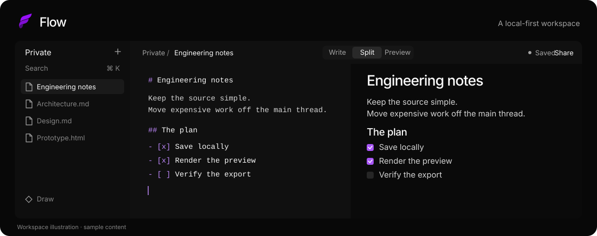
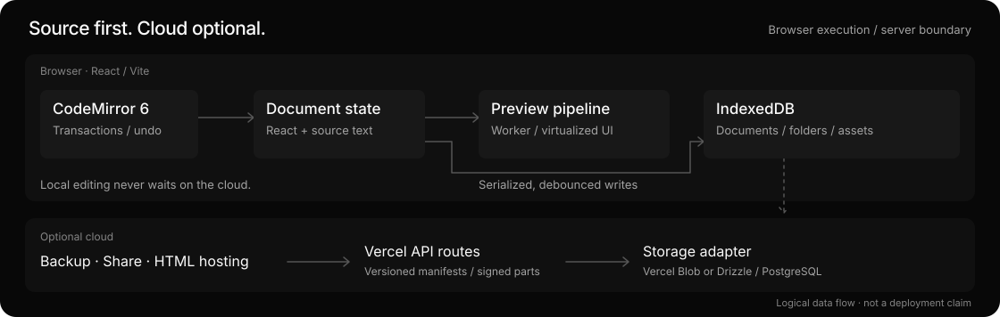

  
  <h1>Flow</h1>
  
A Markdown workspace for writing, engineering and working with the output.

Write and organize Markdown. Preview code, HTML and SVG. Inspect and edit SVG colors, export PDF or PNG, annotate screenshots, publish interactive HTML and share read-only pages. Local editing works without an account; cloud backup is optional.

## 1. The pain point

I built Flow because I kept switching tools to do what felt like one job. Write a technical note, paste a code snippet, check the rendered output, inspect an SVG, export a PDF, annotate a screenshot. None of those steps should be a separate project.

I wanted a tool I could use for hours without fighting the interface. Plain text, fast feedback and output I can actually use. I built it for my own workflow, not as an all-purpose productivity platform.

## 2. Judgment

- **No mandatory accounts, collaboration engine or proprietary document format.** Writing does not need a server in its critical path.
- **No custom text engine.** CodeMirror already solves selection, undo, composition and viewport rendering.
- **No mandatory workspace hierarchy.** The visible navigation is a single Private page tree; existing workspace IDs remain for compatibility.
- **Remove duplicate UI.** No separate title input competing with the document, no outline modal, no source code beneath SVG artwork, no decorative borders around every control.
- **Separate genuinely different problems.** Draw has its own canvas and export engine. HTML runs in an isolated player. Neither belongs inside the Markdown renderer's implementation.

I would rather delete an unnecessary abstraction than spend time making it more elegant.

## 3. Architecture

React 19, TypeScript 5.9, Vite 8, CodeMirror 6. A client-rendered SPA with lazy route boundaries: `/`, `/draw`, `/s/:id` and `/play/:id` (including legacy `/slug/:id` links).

| Layer | Implementation |
|---|---|
| Editor | CodeMirror transactions, language compartments, Markdown syntax tree and undo history. React coordinates the active document and workspace. |
| Preview | React Markdown, remark-gfm, rehype-raw and rehype-sanitize; worker-prepared source chunks, highlight.js and TanStack Virtual. |
| Local storage | IndexedDB v2: documents, folders and workspaces. Serialized per-document saves, bounded localStorage recovery and preference data. |
| Background work | Dedicated workers for preview preparation, search/word counts, formatting, code repair, PDF import and Draw ZIP export. |
| Cloud | Vercel functions for backup, share and site hosting; versioned manifests, signed part URLs and conditional writes. |
| Storage adapter | Vercel Blob or Drizzle ORM 1.0.0-rc.6 / PostgreSQL. The SQL adapter stores path-keyed bytea objects, metadata, ETags and expiry. |

The database is outside the editing path. PostgreSQL support is implemented, but the production cutover is a separate operation; existing Blob installations remain on Blob by default. See the [cutover procedure](docs/postgres-cutover.md).

## 4. Design

I don't want the interface to compete with the work. The document is the product; the toolbar, sidebar and settings are supporting infrastructure.

The visual system is deliberately small: Geist, Phosphor regular icons, neutral surfaces, a slightly darker preview, tight control geometry and a selectable accent independent of light or dark appearance. Borderless by default. Hierarchy comes from tone, spacing and typography, not rectangles drawn around everything.

Motion should explain what changed, not announce that the app has animations. Keep native scrolling native, respect reduced motion and don't animate layout unnecessarily. The HTML player follows the embedded page's appearance rather than imposing Flow's theme on it.

[Design specification](design.md)

## 5. Technical notes

**Input and rendering.** The source remains plain text. Mixed-content detection distinguishes prose from recognizable code. HTML/Python repair removes only known paste wrappers, not guessed program errors. Preview preparation preserves source-line anchors; deferred rendering and virtualization handle long content without mounting the entire document. The prepared-preview cache is bounded to four entries and excludes sources above two million characters.

**Persistence.** The save scheduler uses 340 ms or 900 ms quiet periods based on document size and bounds dirty time to 1,500 ms in the scheduling logic. IndexedDB writes are serialized per document; the recovery snapshot is size-limited. Private backup runs separately with up to six record and six part uploads, a 100 MiB per-file limit and recovery-key access. That is a supported size limit, not a throughput benchmark.

**Isolation.** Markdown HTML is sanitized. Executable HTML uses an opaque-origin sandbox with a CSP and a route bridge; external resources can still use the network. Desktop, iPhone and iPad previews use actual CSS layout dimensions, not simulated Safari or physical DPR. SVG is displayed as script-disabled artwork; editable color ranges are applied back to the source in an undoable edit. PNG allocation is bounded.

**Export.** PDFMake typesets selectable A4 text from the Markdown tree. The pagination pass inspects actual last-page text geometry, optionally renders one compact candidate and keeps it only if the page count decreases. Draw stores annotations in image-relative coordinates, uses a common renderer for preview/export, and packages compressed images with a ZIP/STORE worker.

Key implementation paths: [editor](src/components/MarkdownEditor.tsx), [preview](src/components/MarkdownPreview.tsx), [store](src/lib/store.ts), [backup](src/lib/backup.ts), [HTML runtime](src/lib/htmlPreview.ts), [SVG inspector](src/components/SvgInspector.tsx), [PDF pagination](src/lib/pdfPagination.ts), [Draw](src/draw), [storage](server).

### Run locally

Node.js 22 (22.12+) or 20.19+.

~~~sh
npm install
npm run dev
npm run build
~~~

The [CI workflow](.github/workflows/ci.yml) runs formatting, editor, cloud, PostgreSQL, preview, HTML, interaction and PDF regression tests before the production build. Generate or check the two README SVGs with `python3 scripts/generate_readme_assets.py` (add `--check` to verify).

Local-first is not the same as backed up. Keep the recovery key outside the browser or export important work. A public link is readable by anyone who has it until revoked.

## 6. Upcoming features

The next work is about reliability rather than expanding the product's scope.

- Separate document metadata from large bodies in a versioned IndexedDB migration.
- Persist resumable upload sessions and complete the validated PostgreSQL cutover, including restore, legacy links and rollback.
- Measure boot, input and cloud latency on representative large documents; address the actual bottlenecks.

These are planned improvements, not shipped guarantees. The [performance rollout](docs/performance-rollout.md) records the remaining engineering work.
